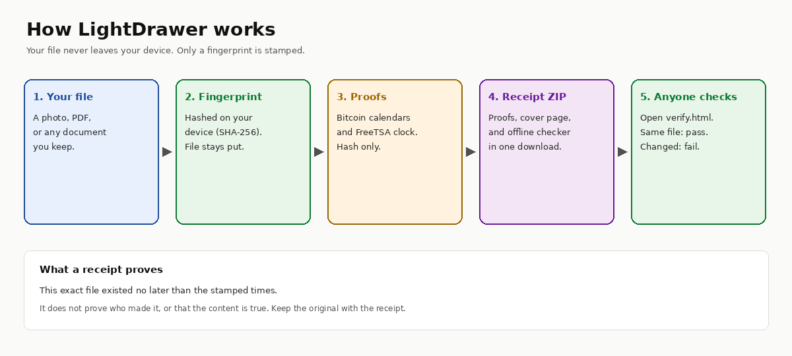
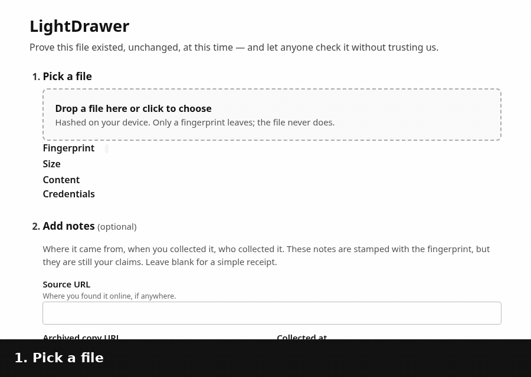

# LightDrawer

[](https://scorecard.dev/viewer/?uri=github.com/desynced/lightdrawer)


**Prove this file existed, unchanged, at this time — and let anyone check it without trusting us.**

Drop a file. Get a receipt. Anyone can check it later — even if this website is gone.

Your file never leaves your device. LightDrawer only uses a *fingerprint*, a short unique code of that exact file, and independent witnesses record that it existed at that moment: Bitcoin, a timestamp authority, and public certificate logs.

It is for journalists, photographers, artists, small businesses, and anyone who needs to show that a photo, video, or document has not been changed since they saved it — for example, when documenting damage for insurance.





## How it works

1. **Drop your file** on the site. It is fingerprinted on your device, so the file itself is never uploaded.
2. **Get your receipt** — a small download to keep with the original file, like a time-stamped ticket.
3. **Anyone can check it** by opening the receipt and, if they have it, the original file. They do not need an account, and they do not have to trust us. Every receipt includes its own checker.

You can also share a lookup link: `https://lightdrawer.org/r/<fingerprint>`. It opens a page that shows whether LightDrawer has a record of that fingerprint, when it was received, and whether a public certificate-log record is ready. The full proof (Bitcoin and the RFC 3161 timestamp) still lives in the receipt file. For a receipt made on this site, the fingerprint in the link is the SHA-256 of `statement.json`, not of the original file alone. A `/?digest=<fingerprint>` address redirects to the same page.

Optional notes about where a file came from can be included. They are saved with the receipt, but they remain your own statements.

A longer, precise walkthrough — what leaves your device, how each proof is built, what is stored, and how to check a receipt with ordinary tools — is in [HOW-IT-WORKS.md](HOW-IT-WORKS.md). What's new, including how the live site is run, is listed in the [changelog](CHANGELOG.md).

## Add a stamp button to your website

You can add a free “Stamp this with LightDrawer” link so visitors can timestamp a file without uploading it. The usual version is a plain HTML link — no JavaScript and no script loaded from this site. A copy-paste guide, including optional CSS and live examples, is at [lightdrawer.org/button](https://lightdrawer.org/button). A standalone demo that pretends to be another website lives in [`examples/stamp-button/example.html`](examples/stamp-button/example.html).

If you already know the file’s SHA-256, add `?expect=<64-hex>` so LightDrawer warns when someone drops a different file. That value is the hash of the **file itself**. Do not put it in `/?digest=` or `/r/…`: those addresses look up a receipt fingerprint, which for a receipt made on this site is the SHA-256 of `statement.json`.

An optional helper script, which you host on your own origin, can hash a file the visitor already chose and open LightDrawer with `#digest=<64-hex>`. Browsers do not send URL fragments to any server. The visitor still drops the same file on LightDrawer to confirm it (receipts keep the existing `statement.json` format) and still completes the human check there.

Do not call `/api/stamp` from another website’s page, and do not put a LightDrawer API key in browser code. API keys are only for your own server (the same pattern Fairview uses). There is no `return=` redirect back to the host site, so the link cannot be used as an open redirect.

## Stamp from an AI tool (MCP)

Developers can stamp, verify, and look up fingerprints from any MCP client — Claude, Cursor, [Koru](https://github.com/koruworks/mono), and others — with a small local server: [lightdrawer-mcp](https://github.com/desynced/lightdrawer-mcp).

```sh
npx -y github:desynced/lightdrawer-mcp#v0.3.1
```

Only the SHA-256 fingerprint is sent to LightDrawer. The local MCP tool can read files on the person’s computer that they (or their AI client) point it at.

No API key is required. Stamps go through an open lane (`POST /api/mcp/stamp`). A public lane should keep the short burst limit and the designed caps: 20 stamps per address per UTC hour, and 500 per UTC day, or stricter. Setting a cap to `0` turns that cap off, which is an operator's choice. If the lane refuses a request or is switched off, the tool gives a browser link instead so the person can finish on the website.

## What's in the receipt

```
<file>.lightdrawer-receipt.zip
├── README.html / README.txt     cover page: what is proven, when, how to check by hand, limits
├── statement.json               the exact bytes that were timestamped (file SHA-256 + optional notes)
├── receipt.json                 machine-readable index (calendars, TSA nonce, Rekor uuid, errors)
├── proofs/statement.json.ots    OpenTimestamps Bitcoin proof (merged from 3 public calendars)
├── proofs/statement.json.tsr    FreeTSA RFC 3161 token
├── proofs/ct.json               certificate-log proof (pending until the next batch certificate)
├── proofs/rekor-entry.json      optional Sigstore Rekor entry (off by default; public and permanent)
├── trust/                       convenience copies of FreeTSA certs and the Rekor public key
└── verify.html                  single-file offline verifier
```

Why a statement instead of the bare file hash: optional notes need to be covered by the same timestamps. Chain: `file → sha256 → statement.json → sha256 → proofs`. Both steps are checkable with `sha256sum`.

## What it proves / what it does not

| Proves | Does not prove |
|---|---|
| A file with this exact SHA-256, plus the statement, existed **no later than** the stamped times | Who made the file or who stamped it |
| The notes were written no later than those times | That the file is authentic, unedited before stamping, or true |
| | That the notes are accurate |
| | Anything about the file without the original bytes (keep the original) |

Timing: FreeTSA (RFC 3161) is immediate. OpenTimestamps is **pending for about 1–6 hours** until a Bitcoin block includes it; after upgrade, no trusted party is required. The certificate-log stamp is pending until the next batch certificate (sub-batches close about every 15 minutes; a certificate is requested about every 6 hours). Rekor (if enabled) is immediate and public.

## Privacy

Only the fingerprint (SHA-256) leaves the device. The file is never uploaded or stored. Files are fingerprinted in 4 MB chunks, so a large video is never loaded fully into memory. The Worker persists SHA-256 fingerprints (not files) in a D1 database (`CT_DB` / `lightdrawer-ct`) until they are sealed into a batch, plus the resulting Merkle data and issued certificate PEMs so a receipt can be upgraded later; see [HOW-IT-WORKS.md](HOW-IT-WORKS.md). Rekor is off by default because a Rekor entry is a public, permanent log of that hash.

For a public source, archive it yourself (perma.cc, Wayback Machine, Arweave) and paste that link into the notes fields.

## Built on (honest credits)

LightDrawer does not invent hashing or timestamps. It packages existing standards into one easy receipt:

- **[OpenTimestamps](https://opentimestamps.org)** — Bitcoin calendar timestamps (the free core of “hash + stamp + verify”)
- **[FreeTSA](https://freetsa.org)** — RFC 3161 timestamp authority
- **Certificate Transparency logs** — extra witness: batch fingerprints into a Merkle tree, encode each root as a hostname, and let a public HTTPS certificate (Let's Encrypt) appear in CT logs. Not a replacement for Bitcoin.
- **[Sigstore Rekor](https://docs.sigstore.dev)** — optional public transparency log (off by default)
- **C2PA Content Credentials** — *read* only; not validated
- **Berkeley Protocol–style fields** — optional provenance notes inside the stamped statement (collector’s own claims)

Paid services (Bernstein, OriginStamp, and others) and app-bound tools (e.g. ProofMode for photos) cover related ground. This project’s bet is a free, readable, self-contained receipt plus an offline verifier that still works if the site disappears.

## Quick start

Needs Node 20+ for build/tests. Current Wrangler wants Node 22+ (use `npx -p node@22` if your default is older).

```sh
npm install
npm test               # build + crypto/self tests (read-only Bitcoin block lookup for a fixture)
npm run test:live      # also stamps a throwaway hash at OTS + FreeTSA; needs openssl and `ots`
npm run dev            # wrangler dev → http://127.0.0.1:8787 (local only)
# Wrangler on Node 22 if needed:
npx -p node@22 npm run dev
python3 test/e2e_browser.py   # Playwright: make a receipt in the UI, verify from file://
npm run check          # wrangler deploy --dry-run (validates config, uploads nothing)
```

`test:live` expects the `ots` client at `.venv-test/bin/ots` (or `OTS_BIN`).

Code layout: `web/lib/*.js` are plain scripts (no bundler), concatenated by `scripts/build.mjs` into `public/app.js` and inlined into single-file `public/verify.html`. Trust anchors in `trust/` are pinned into the build. `src/worker.js` is the only server code.

## Self-host on Cloudflare

Workers + Static Assets (`wrangler.jsonc`). A D1 database (`lightdrawer-ct`, bound as `CT_DB`) holds the certificate-log queue. A cron trigger runs every 15 minutes to close sub-batches and to advance two-phase ACME issuance. No Durable Objects, Workflows, R2, or KV are bound — the original file never leaves the browser. `scripts/ct-anchor.mjs` remains the offline/mock prototype of the same math.

The committed `wrangler.jsonc` is a template with placeholders (empty Turnstile site key, `<your-d1-database-id>`). Keep real deploy IDs out of git: copy it to a private `wrangler.production.jsonc` (gitignored in this repo) and deploy with `wrangler deploy -c wrangler.production.jsonc`.

1. Create a Turnstile widget for your domain. Put the **site key** in a Worker secret (preferred) or only in your private deploy config — do not commit a real value:
   `printf '%s' '<site-key>' | wrangler secret put TURNSTILE_SITE_KEY`
   Also `wrangler secret put TURNSTILE_SECRET` (recommended for a public site). The browser loads the site key from `GET /api/config` at runtime, so static files never hard-code it. Until `TURNSTILE_SECRET` is set, `/api/stamp` skips the human check so local development still works.
2. For the certificate-log stamp, set a Cloudflare API token scoped **only** to Zone DNS Edit on your domain as the Worker secret `CF_DNS_TOKEN`. Also set the zone's ID as the secret `CF_ZONE_ID` (`wrangler secret put CF_ZONE_ID`), and replace the D1 `database_id` placeholder in your deploy config with your own (`wrangler d1 create lightdrawer-ct`). `scripts/ct-issue-remote.mjs` reads `CLOUDFLARE_ACCOUNT_ID`, `CT_DB_ID`, `CF_ZONE_ID`, and `CF_DNS_TOKEN` from the environment. The Worker will create and then delete `_acme-challenge` TXT records under your `CT_HOSTNAME_SUFFIX` only (hosted site uses `ct.lightdrawer.org`).
3. Keep `ACME_DIRECTORY` on the Let's Encrypt staging URL until you have rehearsed issuance. Production ACME directories are refused unless you also set `CT_PRODUCTION` to `"1"`. The hosted site at lightdrawer.org sets both; self-hosters can stay on staging.
4. Add a custom-domain route in your deploy config when you want the Worker on your own domain. Omit it to stay on workers.dev (the hosted project also keeps `workers_dev` enabled).
5. Set `DEFAULT_UPGRADE_PROXY` in `web/ui/verify-ui.js` (and the matching input value in `web/ui/verify.html`) to your public URL. The hosted site uses `https://lightdrawer.org`; self-hosters can use their own `*.workers.dev` URL.
6. Add a WAF rate-limiting rule on `/api/*` (e.g. 20 req / 10 s per IP for `/api/stamp`) before going public, if your Cloudflare plan allows it. Be a good neighbour to free calendars and FreeTSA.
7. `wrangler deploy` (or `wrangler deploy -c wrangler.production.jsonc` if you keep production IDs in that private file).

### What runs where

| Piece | Where it runs | Notes |
|---|---|---|
| Site (`index.html`, `app.js`, `verify.html`) | **Cloudflare Workers Static Assets** | Static; `_headers` sets CSP and other security headers |
| Hashing, statement, ZIP, receipt assembly, local proof checks | **User's browser** (WebCrypto) | File bytes never leave the device |
| `POST /api/stamp` | **Cloudflare Worker** (`src/worker.js`) | Forwards the 32-byte hash to OTS calendars and the RFC 3161 query to FreeTSA (they send no CORS). Browser posts are same-origin only, with Turnstile when the secret is set. Trusted server callers may send `Authorization: Bearer <key>` instead (see below). 10 req/min per IP, or per API key; Bearer attempts are also limited per IP (20/min) before the key is looked up. A same-digest cooldown (`STAMP_DEDUP_MS`, default 1 hour; `0` = off) reuses cached calendar payloads instead of calling calendars again. A cached stamp with no TSR still calls FreeTSA when the request includes `tsq` |
| `POST /api/mcp/stamp` | **Cloudflare Worker** (`src/worker.js`) | Same hash-only body as `/api/stamp` (`digest`, optional `tsq`), with no Turnstile and no API key. Built for the [LightDrawer MCP server](https://github.com/desynced/lightdrawer-mcp). Off until `MCP_LANE` is set to `on`. Shares the same-digest cooldown with `/api/stamp`. A public lane should set `MCP_LIMIT_IP_HOUR` to 20 (or stricter) and `MCP_LIMIT_GLOBAL_DAY` to 500 (or stricter). `0` turns that one cap off on purpose. Burst limit: about 5 requests per 10 seconds per address per location. If `MCP_STAMP_LIMITER` is not bound, the lane returns HTTP 503. Over a cap or a digest cooldown without a cached body: HTTP 429 with `Retry-After`. When the lane is off: HTTP 404 `{"error":"not found"}`. No CORS headers. |
| `GET /api/ots/upgrade` | **Cloudflare Worker** | CORS `*` so `verify.html` works from `file://`; calendar host allowlist; redirects are not followed; edge-cached 1 h; 60 req/min/IP |
| `GET /api/ct/upgrade` | **Cloudflare Worker** | CORS `*`; returns pending until the digest's batch has a stored certificate |
| `GET /r/<fingerprint>` | **Cloudflare Worker** | Public lookup page for a stamped fingerprint. `/?digest=<fingerprint>` redirects here. Optional JSON via `Accept: application/json` or `GET /api/lookup?digest=` |
| Cron `*/15 * * * *` and `POST /api/ct/tick` | **Cloudflare Worker** | Closes due sub-batches; two-phase ACME issuance when `CF_DNS_TOKEN` is set (staging by default; production only if `CT_PRODUCTION=1`) |
| OpenTimestamps calendars / Bitcoin / FreeTSA / Rekor / CT logs | **External** | LightDrawer runs no calendar and does no own anchoring. Rekor is called **directly from the browser** (CORS OK). Certificate-log stamps use Let's Encrypt + public CT logs |

## Server-to-server stamps (API keys)

The public site asks a browser to pass a human check (Cloudflare Turnstile) before it will stamp a hash. Another server — for example a Worker that wants to stamp its own session digests — cannot complete that check. For those trusted callers you can mint a per-caller API key.

Only the SHA-256 hash of the key is stored, in the existing D1 database (`stamp_keys`). The plaintext key is shown once when you mint it and should live as a secret on the caller, not in this repo. A request that sends a valid key in `Authorization: Bearer …` skips Turnstile and uses its own 10-stamps-per-minute limit. Any request that presents a Bearer header is first limited to about 20 attempts per IP per minute, before LightDrawer looks the key up in D1, so junk keys cannot flood the database. Worker logs record the key's label (for example `fairview`); the public receipt is unchanged and does not name the caller. Requests without a key behave exactly as they do today.

Create the table on an existing database (once), then mint a key and insert only its hash:

```sh
wrangler d1 execute lightdrawer-ct --remote --file=migrations/0001_stamp_keys.sql
# If you deploy with a private config: add -c wrangler.production.jsonc to these commands.

node scripts/stamp-key.mjs mint fairview
# Copy the plaintext key into the caller's secret store (shown once).
# Then run the printed wrangler d1 execute … --command "INSERT …" line
# (that SQL contains the hash, not the key).
```

List and revoke:

```sh
wrangler d1 execute lightdrawer-ct --remote --command "SELECT id, label, created_at, revoked_at FROM stamp_keys ORDER BY created_at"
node scripts/stamp-key.mjs revoke-sql <id>
# Then run the printed UPDATE command.
```

Example request (the body is the same as a browser stamp — a 64-character SHA-256 hex digest, and optionally a FreeTSA `tsq`):

```sh
curl -sS https://lightdrawer.org/api/stamp \
  -H 'content-type: application/json' \
  -H "authorization: Bearer $LIGHTDRAWER_STAMP_KEY" \
  --data '{"digest":"e3b0c44298fc1c149afbf4c8996fb92427ae41e4649b934ca495991b7852b855"}'
```

The JSON response is still `{ "ots": { … }, "tsr": null, "errors": [] }` (`tsr` is `null` when the caller omits `tsq`). An empty, unknown, or revoked Bearer key is rejected with HTTP 401 `{"error":"Invalid or revoked API key."}`. Hitting the per-key limit, or the per-IP Bearer-attempt limit, returns HTTP 429 `{"error":"Too many requests. Try again in a minute."}`. A browser request with no `Authorization` header still needs a Turnstile token when `TURNSTILE_SECRET` is set. `/api/stamp` still sends no CORS headers, so this path is for a server caller (no `Origin` header required), not for JavaScript running in another site's page.

New installs that apply `schema/ct.sql` already include the `stamp_keys` table. Self-hosters who use Wrangler migrations can run `wrangler d1 migrations apply lightdrawer-ct --remote` instead of the `--file` command above.

## Open MCP stamp lane

The website still asks a person to pass a short human check before it will stamp. A local MCP server cannot complete that check, and sharing a single API key with every developer would be a poor fit. `POST /api/mcp/stamp` is a separate entrance for those tools.

It accepts the same JSON body as a keyed `/api/stamp` request — `{ "digest": "<64 hex characters>", "tsq": "<optional base64 RFC 3161 request>" }` — and no `Authorization` header. The response on success is the same `{ "ots": { … }, "tsr": …, "errors": [] }` object. The MCP client turns that into a receipt link at `/r/<hash>`.

| Status | When |
|---|---|
| 200 | Body is `{ ots, tsr, errors }`. Calendars are called when this digest is not already in the cooldown cache. A cached stamp is returned as stored; if it has no TSR and the request includes `tsq`, FreeTSA is called for that request only. |
| 400 | Bad JSON, a digest that is not 64 hex characters, or a `tsq` that is not an RFC 3161 request for that digest. |
| 413 | Request body larger than the existing stamp cap. |
| 429 | The burst limit was hit, an hourly or daily cap that is turned on was hit, or the same-digest cooldown has no cached body. Includes a `Retry-After` header. A burst or cap refusal writes one warning, `{ "msg": "mcp stamp limited", "scope": "mcp-burst" }` (or `mcp-ip` / `mcp-global`). That line has no address, digest, or key. |
| 404 | The lane is switched off (`MCP_LANE` is not `on`, or `ct_meta` has `mcp_lane=off`). Body is `{"error":"not found"}`, so the MCP tool falls back to a browser link. |
| 405 | Anything other than POST (including CORS preflight). No CORS headers are sent. |
| 503 | The lane is on, but `MCP_STAMP_LIMITER` is not bound, or the database used for the kill switch and caps is unavailable. Body is `{"error":"stamp lane unavailable"}`. The MCP tool falls back to the browser. |

A public open lane should set `MCP_LIMIT_IP_HOUR` to `20` and `MCP_LIMIT_GLOBAL_DAY` to `500`, or to a smaller number. That is 20 stamps per hashed IP per UTC hour, and 500 stamps per UTC day for the whole lane. The committed `wrangler.jsonc` uses those values. Set either var to `0` only when you mean to turn that cap off. `0` still means off, and a cap that is off writes no counter row. The hosted site currently runs with both caps at `0`. That setting lives in the private deploy config. It is an operator choice. The recommended default in this repository is 20 and 500.

Both this lane and `/api/stamp` also share a same-digest cooldown (`STAMP_DEDUP_MS`, default 1 hour): repeating the same SHA-256 within the window returns the cached calendar payloads instead of calling OpenTimestamps again. A cached stamp with no TSR still calls FreeTSA when the request includes `tsq`, and a returned TSR is stored without extending the calendar cooldown. `0` turns that cooldown off.

In front of those caps, `MCP_STAMP_LIMITER` allows about 5 requests per 10 seconds per address per Cloudflare location. The burst limit is approximate. It sits in front of the hourly and daily caps so a short flood does not reach the public calendars and FreeTSA. If the `MCP_STAMP_LIMITER` binding is missing, the open lane returns HTTP 503 and does not stamp. `/api/stamp` and the upgrade routes still allow the request when their own limiter binding is missing, so local development without those bindings keeps working. Add a WAF rate-limiting rule on `/api/*` as well before a public launch.

The lane stores no raw IP addresses. When the hourly cap is on, each address is stored as HMAC-SHA256 of the IP and the current UTC day, keyed by the `MCP_IP_SALT` secret if set, or by a value derived from `CT_TICK_SECRET` so a deploy can run without an extra secret. Rows live only for the current hour (per address) or current UTC day (the global total) and are deleted by the existing 15-minute cron.

Self-hosters: keep `MCP_LANE` at `off` in the public template until you want the lane. To turn it on, set `MCP_LANE` to `on` in your private deploy config, keep `MCP_STAMP_LIMITER` bound, set the caps to 20 and 500 or stricter (use `0` only to turn a cap off on purpose), apply `migrations/0002_mcp_lane.sql` (or `wrangler d1 migrations apply lightdrawer-ct --remote`), and deploy. To turn the lane off immediately without redeploying: insert `mcp_lane=off` into `ct_meta`. Optional: `wrangler secret put MCP_IP_SALT` if you want the IP hashes keyed separately from `CT_TICK_SECRET`. Apply `migrations/0003_stamp_dedup.sql` (or the same migrations apply) for the same-digest cooldown table; tune `STAMP_DEDUP_MS` in your deploy config if you want a different window. `MCP_ALARM_429_PER_MIN` (default `20`, `0` off) only changes the log warning described below. It does not change who may stamp.

`/api/stamp` still requires the human check when Turnstile is configured, and trusted servers still use their own API keys. Those checks run before the shared digest cooldown.

### Stamp lane logs

Zone HTTP analytics are a separate Cloudflare product, and some API tokens cannot read them. The Worker log is enough to tell the three stamp entrances apart.

Every finished request to `POST /api/stamp` or `POST /api/mcp/stamp` writes one JSON line, including HTTP 4xx and 429:

```json
{"msg":"stamp","path":"/api/mcp/stamp","status":429,"via":"mcp","limited":"burst"}
```

| Field | Meaning |
|---|---|
| `path` | `/api/stamp` or `/api/mcp/stamp` |
| `status` | The HTTP status returned to the caller |
| `via` | `mcp` for the open lane. `key` only after a valid API key was accepted. `turnstile` only after a browser stamp passed the human check. `null` when `/api/stamp` stopped before either of those (bad or missing key, failed human check, or Turnstile is not configured). |
| `limited` | `false` when none of the named caps applied. `burst` is the short MCP burst guard. `ip` is the optional hourly per-address MCP cap. `global` is the optional daily MCP cap. `dedup` is the same-digest cooldown with no cached body. The older per-key and per-address limits on `/api/stamp` still return HTTP 429 with `limited` set to `false`. |

That line does not include the API key, the key id, the key label, the digest, or the client IP. A separate older line still records the label and key id when a key is accepted (`stamp key accepted`). The new line does not.

When `/api/mcp/stamp` returns HTTP 429, the Worker counts those responses for the current UTC minute in memory on that isolate. If the count goes above `MCP_ALARM_429_PER_MIN` (default 20), it writes one extra warning:

```json
{"msg":"mcp-lane-alarm","reason":"429-spike","count":21}
```

It writes that warning at most once per UTC minute per isolate. Set `MCP_ALARM_429_PER_MIN` to `0` to turn it off. Nothing is emailed or sent to Slack. The count is not stored in D1. Each isolate keeps its own count, so one spike can produce one warning from each isolate that crosses the threshold, and a spike spread across many isolates can stay under the threshold on each of them. `/api/stamp` 429s are not part of this count.

Workers Logs are already turned on in `wrangler.jsonc` (`observability.enabled`, with every request sampled). To read the stored lines:

1. In the Cloudflare dashboard, open **Workers & Pages**, select the Worker, and open **Observability**. The account-level Workers Observability page shows the same logs.
2. In the search box, search for the text `"msg":"stamp"` or `"msg":"mcp-lane-alarm"`. `"via":"mcp"`, `"via":"key"`, `"via":"turnstile"`, and `"limited":"burst"` (also `ip`, `global`, and `dedup`) separate the entrances and the caps. The alarm is a warning-level log.
3. For a live view that is not stored, run `npx wrangler tail` from this repo. For the hosted Worker, add `-c wrangler.production.jsonc`. Each stamp request prints that one JSON line.

Invocation logs that Cloudflare adds beside these lines can still show the request URL and other request metadata. The stamp line itself does not add the IP, the digest, or the key.

## Verify without LightDrawer

```sh
sha256sum original.jpg            # must equal statement.json "subject.sha256"
sha256sum statement.json          # every proof is about this hash
openssl ts -verify -data statement.json -in proofs/statement.json.tsr \
  -CAfile freetsa-cacert.pem -untrusted freetsa-tsa.crt   # certs from https://freetsa.org/files/
pip install opentimestamps-client
ots upgrade proofs/statement.json.ots && ots verify -f statement.json proofs/statement.json.ots
curl https://rekor.sigstore.dev/api/v1/log/entries/<uuid>  # if a Rekor entry exists
```

Or open `verify.html` (works from `file://`; sends nothing unless you opt in to online checks).

## Limits / known gaps

- **OTS pending ~1–6 h.** Fresh receipts need an upgrade later (`verify.html` via the proxy, or `ots upgrade`). Keep the upgraded `.ots`.
- **C2PA** is read, not validated (no COSE / hash-binding / trust-list checks). JPEG, PNG, and a generic JUMBF scan are supported. To avoid loading multi-GB files, only the first 16 MB are scanned for Content Credentials.
- **FreeTSA revocation** (CRL/OCSP) is not checked offline. Only FreeTSA's pinned root is trusted (SHA-256 `a6379e7c…18aabc`).
- **Certificate-log stamp** is an extra witness, not a Bitcoin replacement. Let's Encrypt allows 50 new certificates per registered domain per 7 days (refill: 1 every 202 minutes; [rate-limits docs](https://letsencrypt.org/docs/rate-limits/), updated 5 August 2026) and 100 names per certificate. Default schedule: 15-minute sub-batches, a certificate about every 6 hours (~28/week, leaving room for retries). Failed issuance does not immediately retry; the Worker waits the same interval before starting another order. CT logs advertise a maximum merge delay of about 24 hours; they are sharded by certificate expiry and retired shards may stop answering queries (crt.sh and other archives keep copies). The Worker allows Let's Encrypt production only when `CT_PRODUCTION=1` (the hosted lightdrawer.org site sets this). Staging remains the code default. `scripts/ct-anchor.mjs` still refuses production directories. Self-hosters can stay on workers.dev and staging.
- **Rekor submission was not exercised live** (permanent public write). Verification against a real public entry is tested. Uses Rekor v1 at rekor.sigstore.dev; Sigstore is moving toward v2 — recheck before relying on it.
- **OpenTimestamps ops:** sha256, sha1, ripemd160, append, prepend, reverse, hexlify. No keccak256. Bitcoin attestations checked against two public explorers when online checks are on, not a local node.

## Optional later

- **R2 bucket locks** only if you ever host *receipts* (not files) for people. Not a substitute for Bitcoin anchoring.
- **Self-hosters:** leave `CT_PRODUCTION` unset and `ACME_DIRECTORY` on staging until you have rehearsed issuance on your own domain. Keep `CF_DNS_TOKEN` scoped to Zone DNS Edit on that domain only, and point `DEFAULT_UPGRADE_PROXY` at your own workers.dev or custom domain. See [HOW-IT-WORKS.md](HOW-IT-WORKS.md).

## Examples

- `examples/how-it-works.png` — one-page diagram of the flow.
- `examples/lightdrawer-demo.gif` — short walkthrough: pick a file → receipt → verify → tamper fails.
- `examples/demo/harbor-photo.jpg` — sample file used in the demo (plus an edited copy that fails verification).
- `examples/c2pa-sample-receipt/` — browser-made receipt for the C2PA test image (with provenance fields).
- `examples/selftest-receipt/` — receipt from `npm run test:live` plus its original file.
- **Fresh example receipts, made Nov 10, 2026.** The three receipt ZIPs above are complete: each has a Bitcoin (OpenTimestamps) proof, a FreeTSA timestamp, and a certificate-log proof. You can open each one's public receipt page and drop the matching sample file on it to check it:
  - [selftest.txt receipt](https://lightdrawer.org/r/d83f8a256bfc0c6817290c2af8d63c86370147e2f4e7f6cb7009d6fb7a7f97ad)
  - [harbor-photo.jpg receipt](https://lightdrawer.org/r/dc5a0a3bf7081067acbb8c5e2c405ce6e428df064db0cf43b3ca7484dfaa441a)
  - [c2pa-sample-CA.jpg receipt](https://lightdrawer.org/r/19dc6f4e665d7675b6a107bb11097245322d6c5b98599b9058d7e48ae582b260)
- `examples/stamp-button/` — a demo host page with copy-paste stamp and receipt-check buttons (does not include receipt ZIP files).
- `examples/*.png` — screenshots of the maker, verifier, and cover page.

## Verifying releases

Download the release files for a version tag (`lightdrawer-vX.Y.Z.tar.gz`, `verify.html`, and `SHA256SUMS.txt`). In the folder that contains those files, check the checksum and the signed build provenance:

```sh
sha256sum -c SHA256SUMS.txt
gh attestation verify lightdrawer-vX.Y.Z.tar.gz --repo desynced/lightdrawer
```

Replace `vX.Y.Z` with the tag you downloaded. This proves the file was built by this repo's GitHub workflow from that tag.

Tags `v1.0.0` through `v1.4.0` were published before this signing step existed, so they do not have that statement.

## Security

To report a vulnerability, see [SECURITY.md](SECURITY.md). There is no bounty.

[How we keep LightDrawer trustworthy](docs/TRUST.md) lists the controls that are actually in place, and how to check them.

## Support

LightDrawer is free and runs on donated time and free public witnesses. If it's useful to you, you can help keep it running at [paypal.me/josephball](https://paypal.me/josephball).

Updates: [@lightdrawer_org](https://x.com/lightdrawer_org)

## License

MIT. See [`LICENSE`](LICENSE).
